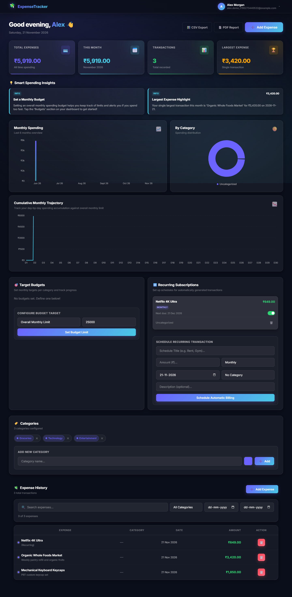
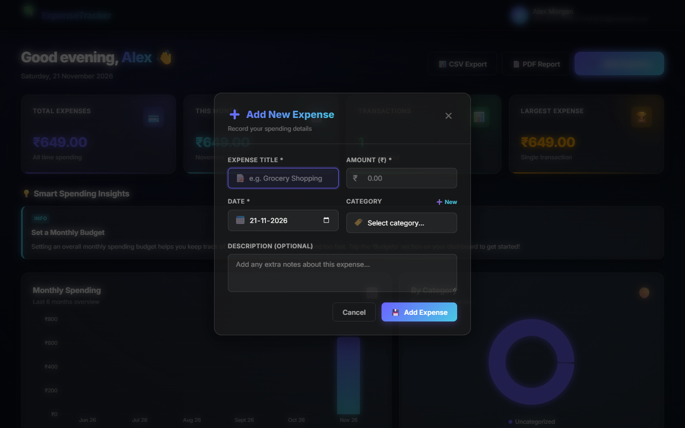
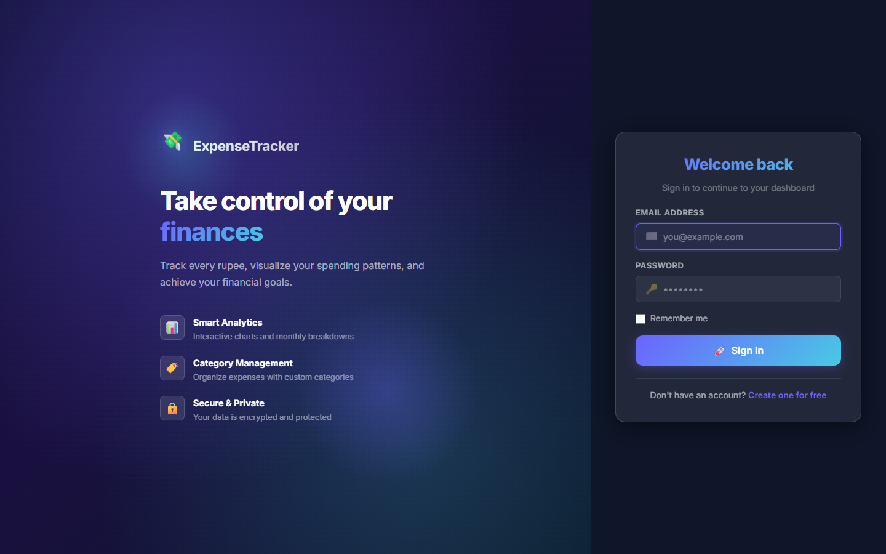
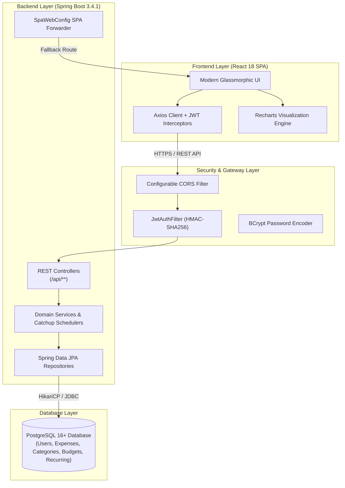

# 🧾 Premium Full-Stack Expense Tracker

[](https://spring.io/projects/spring-boot)
[](https://react.dev/)
[](https://www.postgresql.org/)
[](https://spring.io/projects/spring-security)
[](https://www.docker.com/)
[](https://opensource.org/licenses/MIT)

A modern, production-grade **Full-Stack Expense Tracker and Financial Intelligence Platform** built with **Spring Boot 3**, **React 18**, **PostgreSQL**, and **Spring Security 6**.

Designed with dark-mode glassmorphism, responsive visual analytics, multi-tier budget controls, self-healing recurring transaction automation, and cryptographic JWT session renewal.

---

## 🌐 Live Demo & Repository

- **GitHub Repository**: [https://github.com/saipranav22-commits/expense-tracker](https://github.com/saipranav22-commits/expense-tracker)
- **Live Production URL**: [https://expense-tracker-saipranav.onrender.com](https://expense-tracker-saipranav.onrender.com)
- **Demo Account**:
  - **Email**: `alex.demo@example.com`
  - **Password**: `Password123!`

---

## 📸 Application Screenshots

### 📊 Real-Time Financial Intelligence Dashboard
> Interactive spending analytics with cumulative budget trajectory (Area Chart), 6-month comparative spending (Bar Chart), category distribution (Donut Pie Chart), and automated transaction catchup.



---

### ➕ Inline Category & Expense Creation
> Dynamic expense modal with nested hex color-picker and instant category generation without interrupting data entry.

| Expense Creation Modal | Authentication Gateway |
|:---:|:---:|
|  |  |

---

## 🏛️ System Architecture



---

## ✨ Key Implemented Features

### 1. 🔐 Cryptographic Authentication & Session Prolongation
- Stateless **JWT (JSON Web Token)** authentication using HMAC-SHA256 signing.
- BCrypt salted password hashing with strict Jakarta validation.
- Auto-refresh mechanism (`/api/auth/refresh`) prolonging user sessions seamlessly.

### 2. 📈 Multi-Dimensional Financial Analytics
- **Cumulative Trajectory Chart**: Day-by-day accumulated monthly spend mapped against overall budget threshold.
- **6-Month Velocity Bar Chart**: Historic spending breakdown across previous billing cycles.
- **Dynamic Category Donut Chart**: Proportional category distribution with custom color coding.
- **Automated Insights**: Heuristic analysis surfacing top burn categories and pacing alerts.

### 3. 🎯 Budget Target & Threshold Monitoring
- Set category-specific and overall monthly spending targets.
- Real-time progress bars with dynamic status indicators (`Success` < 80% → `Warning` 80-99% → `Danger` ≥ 100%).

### 4. 🔁 Self-Healing Recurring Transactions
- Create automated recurring transactions (Daily, Weekly, Monthly, Yearly).
- **Startup Catchup Loop**: Automatically detects and retroactively generates missed scheduled transactions incurred during system downtime.
- Active / Inactive toggle control with automated next-due-date calculation.

### 5. 📄 Document Generation & Data Portability
- **CSV Data Export**: One-click streaming download of filtered transaction spreadsheets.
- **Formatted PDF Report**: Invoice-grade PDF summaries generated server-side using OpenPDF.

---

## 🔌 Complete REST API Specification

### 🔐 Authentication & Session
| Method | Endpoint | Auth | Description |
|---|---|:---:|---|
| `POST` | `/api/auth/register` | ❌ | Register new account and receive initial JWT |
| `POST` | `/api/auth/login` | ❌ | Authenticate credentials and return JWT payload |
| `POST` | `/api/auth/refresh` | 🔒 | Validate existing token and issue prolonged token |

### 💸 Expenses Management
| Method | Endpoint | Auth | Description |
|---|---|:---:|---|
| `GET` | `/api/expenses` | 🔒 | List user expenses (supports `search` & `categoryId` query filters) |
| `POST` | `/api/expenses` | 🔒 | Record new expense with amount, date, and category |
| `DELETE` | `/api/expenses/{id}` | 🔒 | Delete expense with ownership verification |
| `GET` | `/api/expenses/summary` | 🔒 | Aggregate monthly total, all-time total, and monthly breakdown |
| `GET` | `/api/expenses/insights`| 🔒 | Retrieve automated velocity and spend distribution insights |

### 🏷️ Category Management
| Method | Endpoint | Auth | Description |
|---|---|:---:|---|
| `GET` | `/api/categories` | 🔒 | List all user-configured categories |
| `POST` | `/api/categories` | 🔒 | Create custom category with custom HEX color |
| `DELETE` | `/api/categories/{id}` | 🔒 | Remove category |

### 🎯 Budgets & 🔁 Recurring Schedules
| Method | Endpoint | Auth | Description |
|---|---|:---:|---|
| `GET` | `/api/budgets` | 🔒 | Get all monthly budget limits and progress |
| `POST` | `/api/budgets` | 🔒 | Define or update category/overall budget limit |
| `DELETE` | `/api/budgets/{id}` | 🔒 | Delete budget target |
| `GET` | `/api/recurring` | 🔒 | List scheduled subscriptions |
| `POST` | `/api/recurring` | 🔒 | Schedule new recurring transaction |
| `PUT` | `/api/recurring/{id}/toggle` | 🔒 | Toggle schedule active/paused state |
| `DELETE` | `/api/recurring/{id}` | 🔒 | Remove recurring schedule |

### 📄 Export Services
| Method | Endpoint | Auth | Description |
|---|---|:---:|---|
| `GET` | `/api/expenses/export/csv` | 🔒 | Stream formatted CSV file |
| `GET` | `/api/expenses/export/pdf` | 🔒 | Stream formatted PDF financial statement |

---

## 🛠️ Tech Stack & Dependencies

| Area | Technology | Purpose |
|---|---|---|
| **Backend Framework** | Spring Boot 3.4.1 | Production REST API core |
| **Language / Runtime** | Java 21 / 23 | Modern LTS Java runtime |
| **Security** | Spring Security 6, JJWT 0.11.5 | Stateless JWT authentication & RBAC |
| **Persistence / ORM** | Spring Data JPA, Hibernate ORM 6.6 | Database abstraction & schema management |
| **Database** | PostgreSQL 16+ | ACID-compliant relational persistence |
| **Document Export** | OpenPDF 1.3.30 | Vector PDF generation |
| **Frontend SPA** | React 18.2.0, React Router v6 | Component-driven UI & client-side routing |
| **Data Visualization**| Recharts 2.10 | Responsive interactive SVG charts |
| **HTTP Client** | Axios 1.6 | Interceptor-managed API communications |
| **Containerization** | Docker (Multi-stage build) | Production image packaging |

---

## 🚀 Local Setup & Installation

### Prerequisites
- **JDK 17+** (JDK 21 or 23 recommended)
- **Node.js 18+** & npm
- **PostgreSQL 14+** running locally or in Docker

### 1. Database Setup
```sql
CREATE DATABASE expensedb;
```

### 2. Backend Setup
```bash
cd backend
# Run via Maven Wrapper
./mvnw clean spring-boot:run
```
*The Spring Boot backend will start on port `8081`.*

### 3. Frontend Setup
```bash
cd frontend
npm install
npm start
```
*The React application will open on `http://localhost:3000`.*

---

## 🚢 Production Deployment

The project includes production-ready Docker packaging and Infrastructure-as-Code for zero-cost deployment.

### Option A: Unified Container (Render / Railway / Koyeb)
1. Fork or push this repository to GitHub.
2. In [Render](https://render.com), click **New +** → **Blueprint** and select this repository.
3. Render reads `render.yaml`, provisions a free **PostgreSQL Database**, builds the multi-stage `Dockerfile`, and serves the full application on a single secure HTTPS URL.

### Option B: Decoupled (Vercel Frontend + Render Backend)
1. Deploy `backend` to Render with `SPRING_DATASOURCE_URL` pointing to **Neon / Supabase**.
2. Deploy `frontend` to Vercel with Root Directory set to `frontend` and Environment Variable:
   ```env
   REACT_APP_API_URL=https://<your-backend-service>.onrender.com/api
   ```

---

## 💼 Resume Bullet Points

- **Architected and deployed a full-stack financial platform** with Spring Boot 3, React 18, and PostgreSQL, featuring stateless JWT authentication with automated session renewal and BCrypt password encryption.
- **Engineered a self-healing recurring transaction engine** that catches up and processes missed subscription schedules across server downtime, paired with multi-metric financial charting (Recharts) and dynamic budget alerts.
- **Implemented multi-stage containerized deployment (Docker, Render, Neon)**, optimizing production artifacts to a 52MB executable container with 12-factor environment variable isolation, CORS controls, and OpenPDF/CSV report generation.

---

## 📄 License
This project is open-source software.
