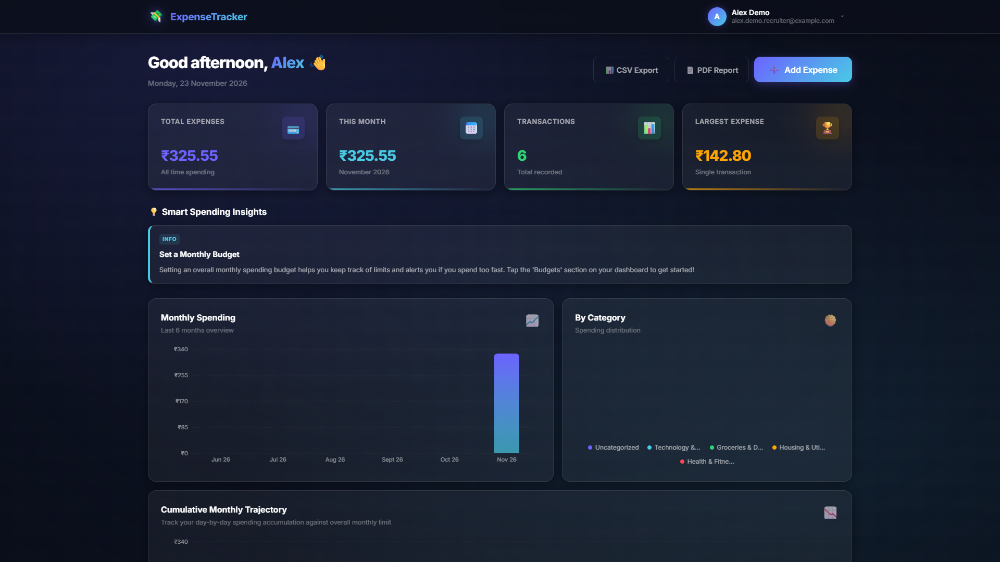
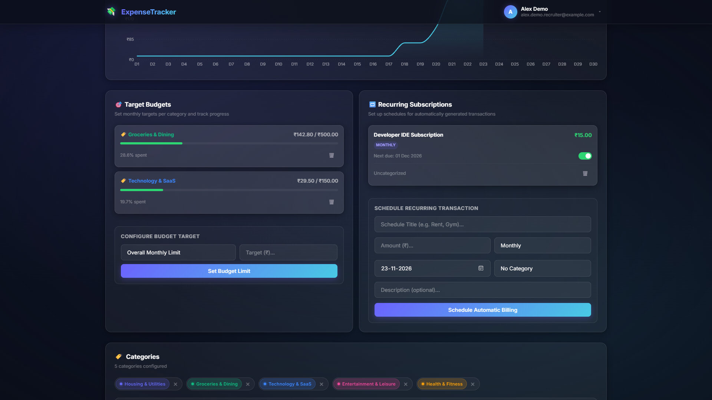
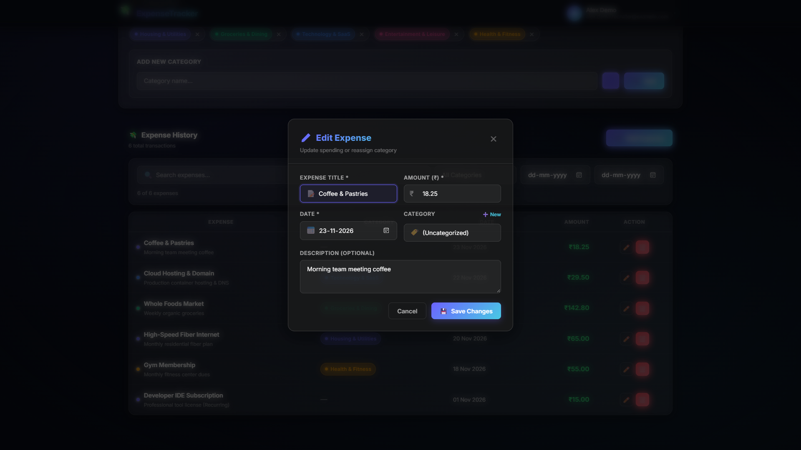
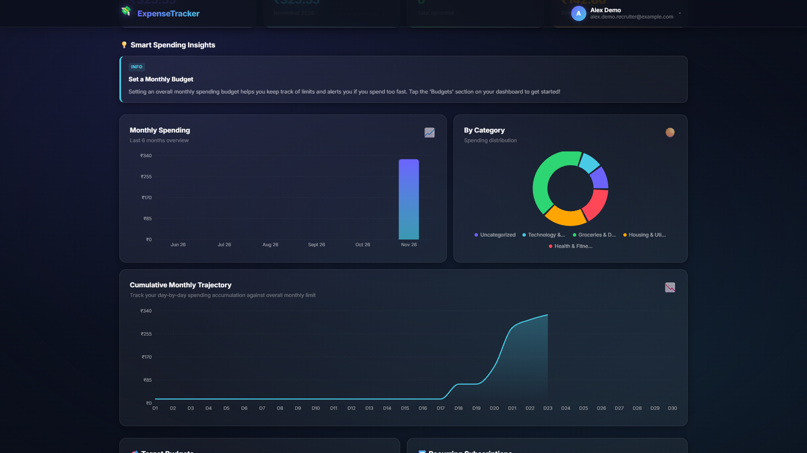
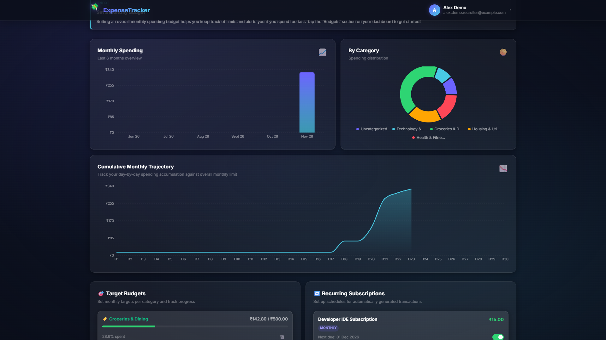
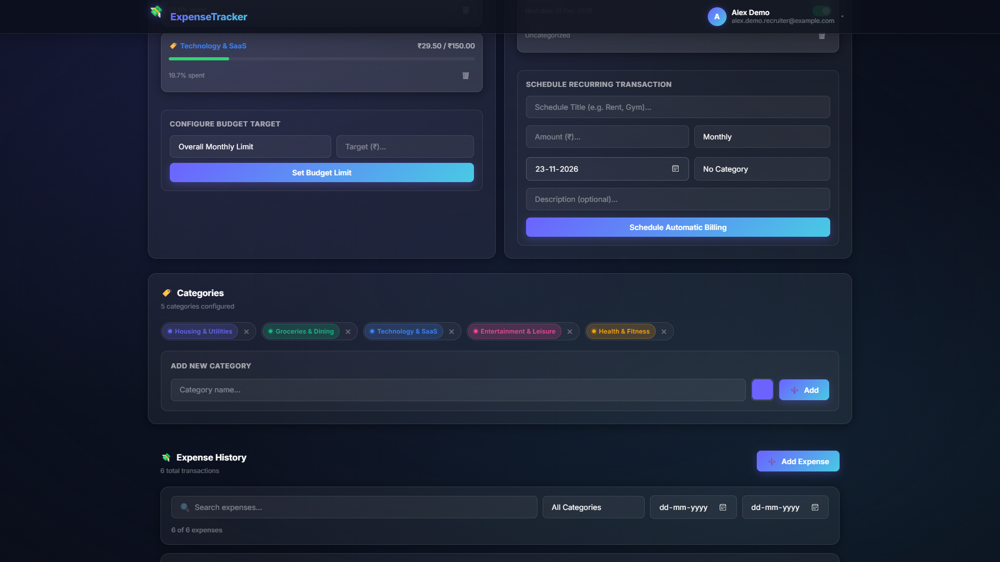
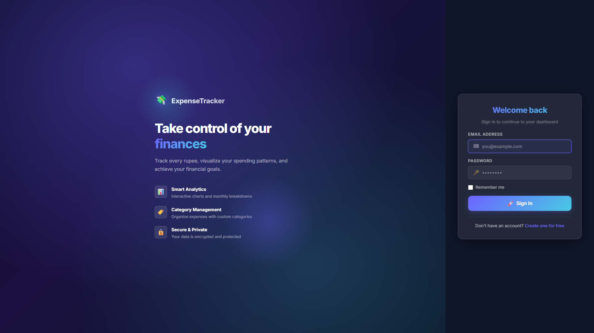

# 🧾 Expense Tracker — Full-Stack Finance & Analytics Platform

[](https://spring.io/projects/spring-boot)
[](https://react.dev/)
[](https://www.oracle.com/java/)
[](https://www.postgresql.org/)
[](https://spring.io/projects/spring-security)
[](https://www.docker.com/)
[](https://render.com)
[](https://opensource.org/licenses/MIT)

A modern, production-grade **Full-Stack Personal Finance & Intelligent Expense Analytics Platform** engineered with **Spring Boot 3**, **React 18**, **PostgreSQL**, and **Docker**.

Deployed live on **Render Cloud** backed by a **Neon Serverless PostgreSQL** database, featuring stateless JWT authentication, reactive category budget tracking, dynamic visual analytics, self-healing recurring transactions, and instant CSV/PDF export capabilities.

---

## 🌐 1. Live Application & Portfolio Links

- 🚀 **Live Production Application:** [https://expense-tracker-app-xxjb.onrender.com/login](https://expense-tracker-app-xxjb.onrender.com/login)
- 🎥 **YouTube Walkthrough Video:** [https://youtu.be/7tUCPydAPa8](https://youtu.be/7tUCPydAPa8)
- 💻 **GitHub Repository:** [https://github.com/saipranav22-commits/expense-tracker](https://github.com/saipranav22-commits/expense-tracker)

> [!NOTE]
> **Render Free Tier Spin-Down Notice:**  
> This application is hosted on Render's free tier. If the service has been inactive, the first request may take 30–50 seconds while the container spins up and initializes the Spring Boot application context and Hikari connection pool. Once warm, subsequent requests execute with sub-second latencies.

---

## 🎥 2. Video Demonstration

Watch the comprehensive architecture, feature walkthrough, and live deployment demonstration on YouTube:

[](https://youtu.be/7tUCPydAPa8)

👉 **[▶️ Watch the Full Project Demonstration on YouTube (5:13)](https://youtu.be/7tUCPydAPa8)**

### Video Chapters:
- `0:00` — Introduction & Cloud Architecture Overview
- `0:43` — Authentication, Stateless JWT & BCrypt Security
- `1:29` — Interactive Dashboard & Financial Intelligence
- `2:11` — Expense Management & Category Reassignment
- `3:06` — Custom Category & Multi-Tier Budget Control
- `3:43` — Recurring Subscriptions & CSV / PDF Exporting
- `4:26` — Mobile Responsiveness & Production Deployment

---

## 📌 3. Project Overview

Managing personal finances often involves fragmented spreadsheets, lack of real-time visibility, and rigid expense categorization. **Expense Tracker** provides a unified, responsive web platform designed to streamline discretionary budget control.

The system is built as a **unified containerized application** where the optimized React Single Page Application (SPA) is built and served directly alongside a robust Spring Boot 3 REST API in an Alpine Linux runtime environment. It eliminates deployment complexity while enforcing enterprise-level security, tenant data isolation, and automated database connection resilience.

---

## ✨ 4. Key Implemented Features

### 💸 Flexible Expense Management & Category Reassignment
- **Full Transaction CRUD:** Record, filter, search, edit, and delete expense entries with amounts, dates, descriptions, and categories.
- **Post-Creation Category Reassignment:** Quickly record fast expenses as *Uncategorized* and assign them later to custom categories via a prefilled modal.
- **Reactive State Propagation:** Saving an edit triggers an authenticated `PUT /api/expenses/{id}` request and recalculates monthly totals, budget progress, and charts in React state without full page refreshes.

### 📊 Real-Time Financial Intelligence & Analytics
- **KPI Summary Cards:** Instant visibility into Total Monthly Spend, Configured Budget Limits, Remaining Balances, and the Largest Recorded Transaction.
- **Interactive Visuals (Recharts):** Responsive category spending distribution donut charts, 6-month historical spending velocity bars, and cumulative monthly trajectories.
- **Automated Spending Alerts:** Automated heuristic insights warning users when category spending approaches or exceeds budget limits.

### 🎯 Multi-Tier Category Budget Monitoring
- Define granular monthly spending caps per category with custom hex colors and visual icons.
- Visual utilization indicators provide instant feedback: **Healthy** (<80%), **Warning** (80%–99%), and **Exceeded** (≥100%).

### 🔁 Self-Healing Recurring Subscriptions
- Schedule recurring expenses (Daily, Weekly, Monthly, Yearly) for fixed liabilities (e.g., Netflix, AWS, Rent).
- One-click active/paused status toggling with dynamic next-payment calculation.
- **Startup Catch-Up Engine:** Automatically detects and generates missed recurring transactions if the application was idle or offline during a billing interval.

### 📄 Document Generation & Data Portability
- **CSV Data Export:** Stream filtered transaction history directly into spreadsheet-ready CSV format.
- **Executive PDF Export:** Generate formatted, invoice-grade financial statements server-side using **OpenPDF 1.3.30**.

### 📱 Responsive Glassmorphic Design
- Mobile-first layout crafted with Tailwind CSS and modern Lucide icons.
- Fully optimized for desktop, tablet, and mobile viewports with collapsible side navigation and touch-friendly cards.

---

## 📸 5. Application Screenshots

### 📊 1. Real-Time Financial Intelligence Dashboard
> Comprehensive spending overview featuring glassmorphic metric cards, category donut distribution, monthly trend bars, and automated spending pacing insights.



---

### 💳 2. Transaction History & Filtering Table
> High-density expense ledger with real-time text search, category-specific filtering, and quick-action edit/delete triggers.



---

### ✏️ 3. Expense Creation & Category Reassignment
> Prefilled transaction modal allowing users to update amounts, descriptions, and assign previously Uncategorized expenses to established categories.

| ➕ Add New Transaction | ✏️ Edit & Reassign Category |
|:---:|:---:|
|  |  |

---

### 🎯 4. Category Budget Management & Threshold Indicators
> Granular monthly budget caps with dynamic visual utilization progress bars and real-time threshold monitoring.



---

### 📈 5. Interactive Analytics & Category Breakdown
> Multi-dimensional visual analytics powered by Recharts, offering actionable insights into discretionary cash flow.



---

### 🔁 6. Recurring Subscriptions & Automation
> Dedicated recurring commitment scheduler with active/inactive state toggles and automated next-billing calculation.



---

### 🔐 7. Glassmorphic Authentication Portal
> Secure entry portal utilizing BCrypt password encryption, stateless JWT generation, and responsive client-side validation.



---

## 🛠️ 6. Technology Stack

| Layer | Technology | Version | Purpose |
|---|---|---|---|
| **Frontend Framework** | React | 18.2.0 | Component-driven Single-Page Application (SPA) |
| **Routing** | React Router DOM | 6.22.0 | Client-side declarative routing and protected routes |
| **Styling & UI** | Tailwind CSS / Lucide React | 3.4.1 | Glassmorphic dark-mode theme and iconography |
| **Data Visualization** | Recharts | 2.10.3 | Interactive SVG charts (Donut, Bar, Progress) |
| **HTTP Client** | Axios | 1.6.7 | REST API communication with JWT interceptors |
| **Backend Framework** | Spring Boot | 3.4.1 | Production-ready RESTful web service framework |
| **Language / Runtime** | Java | 21 LTS | Modern Java LTS runtime with virtual threads support |
| **Security Framework** | Spring Security / JJWT | 6.0 / 0.11.5 | Stateless JWT authentication & authorization filter |
| **Persistence / ORM** | Spring Data JPA / Hibernate | 6.6.x | Relational object mapping and transactional queries |
| **Database** | PostgreSQL | 16+ (Neon) | Serverless relational database with SSL encryption |
| **Connection Pooling** | HikariCP | 5.1.0 | High-performance JDBC connection pool |
| **Document Generation** | OpenPDF | 1.3.30 | Server-side formatted PDF generation |
| **Containerization** | Docker | Multi-Stage | Unified, reproducible container packaging |
| **Cloud Hosting** | Render | Free Web Service | Continuous deployment from GitHub `main` branch |

---

## 🏛️ 7. System Architecture

The application is deployed as a **unified containerized service**, eliminating CORS overhead and proxy complexity in production by packaging the compiled React static bundle inside the Spring Boot jar artifact.

```mermaid
flowchart TD
    subgraph Client ["Client Tier (Browser)"]
        UI["React 18 SPA (Tailwind CSS)"]
        Axios["Axios Client + JWT Interceptors"]
        Recharts["Recharts Visualization Engine"]
        UI --> Axios
        UI --> Recharts
    end

    subgraph Container ["Unified Docker Container (Render Cloud)"]
        subgraph Security ["Security & Gateway Filter Chain"]
            CORS["Domain-Restricted CORS Filter"]
            JWT["JwtAuthFilter (HMAC-SHA256)"]
            BCrypt["BCrypt Salted Password Encoder"]
        end

        subgraph Backend ["Server Tier (Spring Boot 3.4.1 / Java 21)"]
            Controller["REST Controllers (/api/**)"]
            Service["Domain Services & Catch-Up Scheduler"]
            Repo["Spring Data JPA Repositories"]
            SpaRoute["SpaWebConfig (HTML5 PushState Forwarder)"]
            PdfEngine["OpenPDF 1.3.30 Generation Engine"]

            Controller --> Service
            Service --> Repo
            Service --> PdfEngine
        end
    end

    subgraph Database ["Database Tier (Neon Cloud)"]
        Neon[("Neon Serverless PostgreSQL 16\n(Users, Expenses, Categories, Budgets, Recurring)")]
    end

    UI -->|HTTPS / Static Assets| SpaRoute
    Axios -->|REST API Requests (Bearer Token)| CORS
    CORS --> JWT
    JWT --> Controller
    Repo -->|HikariCP / TLS Port 5432| Neon
```

### Build Pipeline:
1. **Stage 1 (Node 20 Alpine):** Installs frontend dependencies via `npm ci` and compiles the React production bundle (`build/`).
2. **Stage 2 (Maven 3.9 + OpenJDK 21):** Copies React build artifacts into `backend/src/main/resources/static/` and packages a self-contained Spring Boot executable JAR.
3. **Stage 3 (Eclipse Temurin 21 JRE Alpine):** Copies the compiled JAR into a minimal, unprivileged runtime container (<250MB image).

---

## 🔒 8. Authentication and Security Architecture

- **Stateless Authentication:** User sessions do not rely on server memory or HTTP session cookies. Authentication state is maintained via cryptographically signed **HMAC-SHA256 JWT tokens** with 24-hour lifespans.
- **Salted Password Hashing:** Passwords are never stored in plaintext. They are encrypted using **BCrypt** with an adaptive work factor before persisting to PostgreSQL.
- **Per-Tenant Data Isolation:** Every query in `ExpenseRepository`, `CategoryRepository`, `BudgetRepository`, and `RecurringExpenseRepository` enforces user ownership (`findByUser(user)`), preventing unauthorized cross-tenant data access.
- **Injection & Threat Mitigation:**
  - **SQL Injection:** Mitigated via Spring Data JPA parameterized queries and Hibernate ORM abstraction.
  - **XSS & CORS:** Strict production CORS filters allow requests only from authorized domains with preflight verification.
  - **Routing Security:** Non-API endpoints fallback safely to `index.html` via `SpaWebConfig`, preventing directory traversal.

---

## 🔌 9. REST API Specification

### 🔐 Authentication (`/api/auth`)
| Method | Endpoint | Auth | Description |
|---|---|:---:|---|
| `POST` | `/api/auth/register` | ❌ Public | Register a new user account and obtain initial JWT token |
| `POST` | `/api/auth/login` | ❌ Public | Authenticate credentials and receive JWT bearer payload |
| `POST` | `/api/auth/refresh` | 🔒 Bearer | Prolong active session token |

### 💸 Expenses (`/api/expenses`)
| Method | Endpoint | Auth | Description |
|---|---|:---:|---|
| `GET` | `/api/expenses` | 🔒 Bearer | Retrieve expenses (supports optional `search` and `categoryId` filters) |
| `POST` | `/api/expenses` | 🔒 Bearer | Create a new expense record |
| `PUT` | `/api/expenses/{id}` | 🔒 Bearer | **Update existing expense (e.g., assign category to Uncategorized)** |
| `DELETE` | `/api/expenses/{id}` | 🔒 Bearer | Delete expense record with ownership validation |
| `GET` | `/api/expenses/summary` | 🔒 Bearer | Get aggregated monthly totals, expense count, and category breakdown |
| `GET` | `/api/expenses/insights` | 🔒 Bearer | Retrieve automated pacing and burn rate heuristic alerts |
| `GET` | `/api/expenses/export/csv` | 🔒 Bearer | Stream filtered transaction history as formatted CSV |
| `GET` | `/api/expenses/export/pdf` | 🔒 Bearer | Stream formatted executive PDF financial report (OpenPDF) |

### 🏷️ Categories (`/api/categories`)
| Method | Endpoint | Auth | Description |
|---|---|:---:|---|
| `GET` | `/api/categories` | 🔒 Bearer | List all custom categories for the authenticated user |
| `POST` | `/api/categories` | 🔒 Bearer | Create a new custom category with name, hex color, and icon |
| `DELETE` | `/api/categories/{id}` | 🔒 Bearer | Delete a category (reassigns linked expenses to Uncategorized) |

### 🎯 Budgets (`/api/budgets`)
| Method | Endpoint | Auth | Description |
|---|---|:---:|---|
| `GET` | `/api/budgets` | 🔒 Bearer | Retrieve all category monthly budget limits and current spending progress |
| `POST` | `/api/budgets` | 🔒 Bearer | Create or update a category monthly budget limit |
| `DELETE` | `/api/budgets/{id}` | 🔒 Bearer | Delete a budget limit |

### 🔁 Recurring Subscriptions (`/api/recurring`)
| Method | Endpoint | Auth | Description |
|---|---|:---:|---|
| `GET` | `/api/recurring` | 🔒 Bearer | List scheduled recurring commitments |
| `POST` | `/api/recurring` | 🔒 Bearer | Schedule a new recurring expense (Daily, Weekly, Monthly, Yearly) |
| `PUT` | `/api/recurring/{id}/toggle` | 🔒 Bearer | Toggle subscription between active and paused states |
| `DELETE` | `/api/recurring/{id}` | 🔒 Bearer | Remove a recurring subscription schedule |

---

## 🚀 10. Local Setup & Installation

### Prerequisites
- **Java Development Kit (JDK 21 LTS)** installed and configured in `PATH`
- **Node.js (v18+)** and **npm (v9+)**
- **PostgreSQL 14+** running locally (or via Docker)
- **Git**

### Step 1: Clone the Repository
```bash
git clone https://github.com/saipranav22-commits/expense-tracker.git
cd expense-tracker
```

### Step 2: Configure Database
Open your PostgreSQL terminal (`psql`) and create a dedicated database:
```sql
CREATE DATABASE expensedb;
```

### Step 3: Run the Backend
```bash
cd backend
# On Linux / macOS
./mvnw clean spring-boot:run

# On Windows PowerShell
.\mvnw.cmd clean spring-boot:run
```
*The Spring Boot server will initialize on port `8081`.*

### Step 4: Run the Frontend
In a new terminal window:
```bash
cd frontend
npm install
npm start
```
*The React development server will start at `http://localhost:3000` and proxy API calls to port `8081`.*

### Step 5: (Alternative) Run Full Stack with Docker
```bash
docker build -t expense-tracker .
docker run -p 8081:8081 \
  -e SPRING_DATASOURCE_URL=jdbc:postgresql://host.docker.internal:5432/expensedb \
  -e SPRING_DATASOURCE_USERNAME=postgres \
  -e SPRING_DATASOURCE_PASSWORD=your_password \
  -e JWT_SECRET=your_512_bit_secret_key_minimum_64_characters_long_for_security \
  expense-tracker
```
Access the application at `http://localhost:8081`.

---

## ⚙️ 11. Environment Variable Configuration

The application is built around the **12-Factor App methodology**. All sensitive parameters are injected through environment variables without hardcoded credentials:

| Variable | Required | Default / Example | Purpose |
|---|:---:|---|---|
| `PORT` | No | `8081` | Web server port (automatically mapped by Render) |
| `SPRING_DATASOURCE_URL` | **Yes** | `jdbc:postgresql://<host>:5432/expensedb?sslmode=require` | JDBC database connection string |
| `SPRING_DATASOURCE_USERNAME` | **Yes** | `expense_user` | PostgreSQL database user |
| `SPRING_DATASOURCE_PASSWORD` | **Yes** | `••••••••••••` | PostgreSQL database password |
| `JWT_SECRET` | **Yes** | `••••••••••••` | Minimum 256-bit secret key for HMAC-SHA256 JWT signing |
| `CORS_ALLOWED_ORIGINS` | No | `https://expense-tracker-app-xxjb.onrender.com` | Comma-separated list of permitted origins |

---

## ☁️ 12. Deployment Architecture — Render + Neon PostgreSQL

The live production deployment utilizes two modern cloud platforms:

1. **Render Cloud (Web Service):**
   - Automatically monitors the GitHub `main` branch.
   - Executes the multi-stage `Dockerfile` on every push.
   - Manages SSL certificates and automatic HTTPS termination.
   - Maps internal container port `8081` directly to public traffic.

2. **Neon Serverless PostgreSQL:**
   - Provides serverless, auto-scaling PostgreSQL 16 database storage with automated point-in-time recovery.
   - Enforces encrypted SSL/TLS connections (`sslmode=require`).
   - Pairs with backend HikariCP connection pool settings configured for sleep resilience:
     ```properties
     spring.datasource.hikari.max-lifetime=1800000
     spring.datasource.hikari.connection-timeout=30000
     spring.datasource.hikari.keepalive-time=30000
     ```

---

## 💡 13. Engineering Challenges & Solutions

### 1. Docker Multi-Stage Build & Dependency Lockfile Drift
- **Problem:** Initial production Docker builds failed during `npm ci` due to version mismatches between `package.json` and `package-lock.json` across differing local and container Node/npm environments.
- **Solution:** Diagnosed transitive dependencies involving `yaml` and `postcss-load-config`. Regenerated a clean, synchronized `package-lock.json` preserving TypeScript 4.9.5 compatibility with `react-scripts 5.0.1`, ensuring 100% deterministic, zero-warning builds in `node:20-alpine`.

### 2. Post-Creation Category Reassignment & Reactive UI
- **Problem:** Users frequently record quick purchases without specifying a category. Initially, categorizing an expense required deleting and re-creating the transaction.
- **Solution:** Implemented `PUT /api/expenses/{id}` with prefilled modal editing in React. Added backend validation in `ExpenseService` ensuring proper JPA association with custom categories while preventing unauthorized cross-user category assignments. Updated the React client to update local state in-place, dynamically recalculating budget bars and donut charts without a page reload.

### 3. Serverless DB Connection Dropping (Neon Cold Starts)
- **Problem:** Serverless PostgreSQL instances temporarily sleep during periods of inactivity, causing stale connection exceptions in unmanaged JDBC pools.
- **Solution:** Tuned HikariCP connection pool parameters with aggressive keep-alive heartbeats (`keepaliveTime=30s`) and validation timeouts to transparently re-establish database connections before processing incoming HTTP requests.

### 4. Single-Page Application Client Routing on Monolith Containers
- **Problem:** Direct browser navigation or refreshing a deep React route (e.g., `/expenses` or `/login`) caused Spring Boot to return HTTP 404 because no matching backend REST controller existed.
- **Solution:** Configured `SpaWebConfig` to implement Spring's `WebMvcConfigurer`, automatically forwarding non-API requests (`/{path:[^\\.]*}`) to `index.html` and enabling seamless HTML5 PushState client routing.

---

## 🔮 14. Future Improvements

- [ ] **Multi-Currency Support:** Integration with a real-time exchange rates API for automatic conversion across international currencies.
- [ ] **Receipt OCR Scanning:** Intelligent extraction of dates, amounts, and merchant names from uploaded receipt images via Tesseract OCR.
- [ ] **Shared Group Budgets:** Multi-user shared household wallets with split-expense calculations and collaborative permissions.
- [ ] **Budget Webhook Alerts:** Automated notification delivery to Discord, Slack, or Telegram when monthly spending reaches 90% of budget limits.

---

## 📄 15. License

This project is licensed under the **MIT License** — feel free to inspect, fork, and adapt it for your own portfolio and financial tracking needs.
